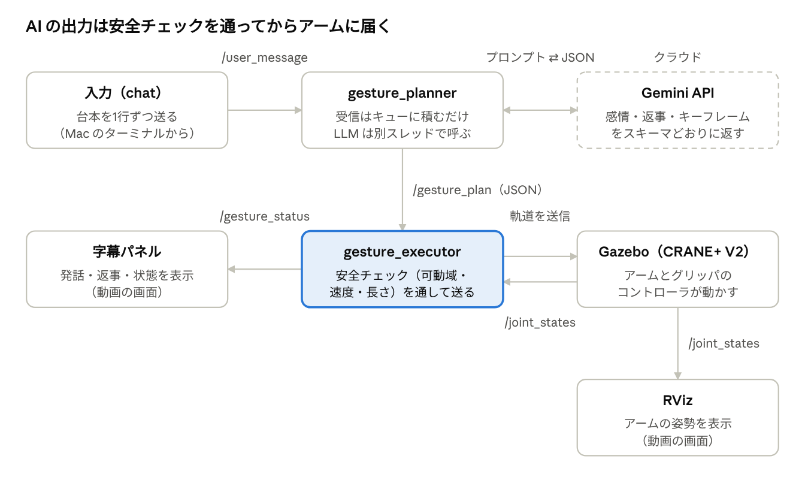

# crane_gesture — 言葉から身ぶりを振り付けるロボットアーム

入力したテキストから Gemini が気持ちを読み取り、卓上アーム CRANE+ V2 の身ぶり（関節角度のキーフレーム列）をその場で生成して応えます。ROS 2 Humble ＋ Gazebo 上で動きます。東京大学 松尾研究室「Physical AI 2026 応用編1」の最終課題です。

- 例：「テストで100点だった！」と入力 → アームが弾むように喜び、「100点すごい！おめでとう！」と返す
- 同じ「やばい」でも、文脈が喜びなら弾み、焦りなら縮こまる（用意したモーションから選ぶのではなく、毎回振り付ける）
- 入力から動き出すまで約2秒（gemini-flash-lite-latest、推論の深さ low）

## システム構成



| ノード | 役割 |
| --- | --- |
| `gesture_planner` | `/user_utterance`（入力テキスト）を受けて Gemini を呼び、JSON スキーマで縛ったプラン（感情・意図・返事・キーフレーム列）を `/gesture_plan` に出す。LLM 呼び出しは別スレッド |
| `gesture_executor` | プランを安全チェック（`gesture.validate`）に通し、現在の `/joint_states` を起点にアームとグリッパの軌道を FollowJointTrajectory で送る。補正内容は `/gesture_status` に流す |
| `chat` | 端末からテキストを送る（`--file` で台本を1行ずつ送る） |
| `caption` | 入力文・返事・感情を表示する字幕パネル（動画用） |
| `record_demo` | 台本を送りながら x11grab で録画し、各デモの時刻・感情・応答時間・補正を JSON に記録 |

AI を使うのは planner だけで、アームに指令を出せるのは executor だけです。

### 安全チェック（`crane_gesture/gesture.py`）

| チェック | 違反したときの処理 |
| --- | --- |
| 可動域（URDF の限界より内側。例：肩 ±80°） | 範囲内に切り詰める |
| 関節速度（上限 90°/秒） | その区間の時間を延ばす |
| キーフレーム数（最大24）・総時間（最大15秒） | 超過分を捨てる／実行を拒否する |
| 欠けた値・NaN | 直前の値を保持する |
| 終了姿勢 | 直立に戻す区間を足す |

API キーが無い・通信に失敗した・形式が崩れた場合は、手作りのジェスチャ（喜び・悲しみ・同意・お辞儀）から近いものを実行します。

## 必要なもの

- Docker Desktop（Apple Silicon の Mac で確認。イメージは amd64 なので Rosetta で動く）
- Gemini の API キー（[Google AI Studio](https://aistudio.google.com/apikey)）。無くてもフォールバックのジェスチャで動く
- 動画編集を使う場合のみ：Mac 側に Python 3 ＋ Pillow、ffmpeg

## セットアップ

```bash
git clone https://github.com/dsplay70/pai-crane-gesture.git
cd pai-crane-gesture
cp .env.example .env          # GEMINI_API_KEY を書く
./run_pai_container.sh        # 講義の演習用イメージでコンテナ pai_ros2 を作る（このフォルダが /workspace）
docker exec -it -u ubuntu pai_ros2 bash /workspace/setup_container.sh   # 依存の導入と colcon build
```

ブラウザで http://localhost:6080/ を開くとコンテナのデスクトップが使えます。

## 動かす

コンテナ内のターミナルで：

```bash
# 1. シミュレータ
ros2 launch crane_plus_gazebo crane_plus_with_table.launch.py

# 2. ジェスチャ生成・実行（別ターミナル）
ros2 launch crane_gesture gesture.launch.py          # ノードのみ
ros2 launch crane_gesture demo.launch.py             # 動画用（RViz・字幕パネル・ウィンドウ配置つき）

# 3. テキストを入力する（別ターミナル）
ros2 run crane_gesture chat
```

モデルは `.env` の `GEMINI_MODEL`（既定 `gemini-flash-lite-latest`）または launch 引数 `model:=...` で変えられます。コンテナ内は日本語入力ができないため、Mac から送るときは `./send_demo_lines.sh` を使います。

テスト：

```bash
cd /workspace/src/crane_gesture && python3 -m pytest test
```

## デモ動画の録画と編集

```bash
# コンテナ内：画面を固定し、台本 demo_lines.txt を送りながら録画
xrandr -s 1920x1080
CLEAN=1 /workspace/install/crane_gesture/share/crane_gesture/scripts/arrange_windows.sh
ros2 run crane_gesture record_demo --lines /workspace/demo_lines.txt --out /workspace/videos/take.mp4

# Mac：記録した JSON をもとに自動カットし、タイトル・テロップを入れて書き出す
python3 video/make_video.py videos/take.mp4 --repo https://github.com/dsplay70/pai-crane-gesture
```

## ファイル構成

```
src/crane_gesture/      ROS 2 パッケージ（ament_python）
  crane_gesture/        gesture.py（関節定義・安全チェック） llm.py（Gemini 呼び出し） *_node.py
  launch/ rviz/ scripts/ test/
video/make_video.py     提出動画の自動編集
demo_lines.txt          デモの台本
run_pai_container.sh    コンテナ作成
setup_container.sh      コンテナ内のセットアップ
```

## 使用技術

Gemini（google-genai SDK、構造化出力）／ROS 2 Humble／Gazebo／CRANE+ V2（crane_plus_gazebo）／pytest／ffmpeg／Pillow。演習環境は [AI-Robot-Book-Humble/docker-ros2-desktop-ai-robot-book-humble](https://github.com/AI-Robot-Book-Humble/docker-ros2-desktop-ai-robot-book-humble) のイメージを使っています。

## ライセンス

MIT License（[LICENSE](LICENSE)）
